見出し付きの複数のセクションを縦に並べ、それぞれのコンテンツを開閉するコンポーネントです。

Collapsible との違い：複数の項目を1つのまとまりとして扱い、各項目は見出しを持ちます。矢印キーで見出し間を移動でき、1つだけ開くか複数開けるかを切り替えられます。開閉する領域が1つだけの場合は Collapsible を使います。

## 構造・挙動

### アコーディオン

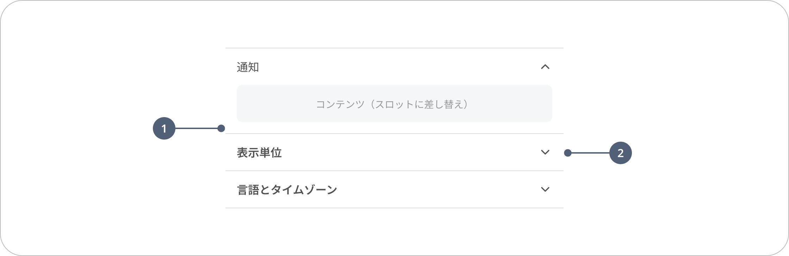

| 番号 | 名前 | Name | 説明 |
| --- | --- | --- | --- |
| 1 | コンテナ | Container | 項目を縦に並べる。区切り線や枠の表示はアピアランスで決まる。type で、1つだけ開く（single）か複数開ける（multiple、既定）かを切り替える |
| 2 | 項目 | Item | 見出しとコンテンツをまとめた要素（NgiAccordion/Element/Item）。disabled で開閉を不可とする。無効にする場合は理由を伝える |

### アコーディオン要素-項目

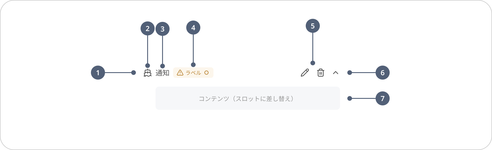

| 番号 | 名前 | Name | 説明 |
| --- | --- | --- | --- |
| 1 | 見出し | Header | 見出し要素（headingLevel、既定 3）の中にボタンを配置し、行全体を押せるようにする。ボタンの名前はタイトルだけとし、末尾側項目は説明として関連付ける。上下の矢印キー・Home / End で見出し間を移動する |
| 2 | 先頭側項目 | Leading Item | タイトルの左に配置する項目（アイコン、アバターなど。複数配置できる）。showLeadingItem で表示する。コンテンツの左端は、先頭側項目の分も字下げしてタイトルに揃える |
| 3 | タイトル | Title | セクションの名前。開閉に合わせて文言を変えない名詞にする。長い場合は省略せず折り返す |
| 4 | 末尾側項目 | Trailing Item | タイトルの右に配置する項目（バッジ、アイコンなど。2〜3個程度まで）。showTrailingItem で表示する。狭い幅ではタイトルの下の行に移動する。ステータスは文字で示す |
| 5 | アクション | Actions | 見出しのボタンの外（兄弟要素）に重ねて配置する操作（アイコンのみのボタンなど。1〜2個まで）。trailing では開閉アイコンの左、leading では行の右端に配置する。押しても開閉しない。矢印キーでの移動の対象にしない。ボタンの名前には何に対する操作かを含める |
| 6 | 開閉アイコン | Icon | 開閉の状態を示す。trailing は行の右端に配置し、閉じているときは下向き、開いているときは上向き。leading はタイトルの左に配置し、閉じているときは右向き、開いているときは下向き |
| 7 | コンテンツ | Content | 開閉する領域（スロット）。閉じているときは非表示とし、読み上げ・Tab 移動の対象にしない。role="region" を持ち、名前はタイトルとする |

## 種類

### アピアランス（appearance）

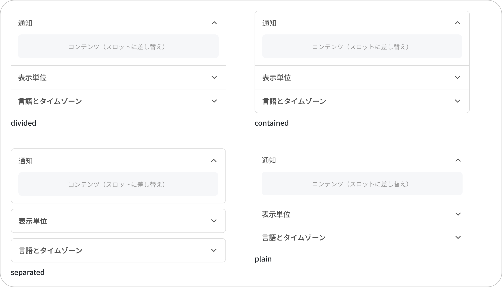

| 値 | 見た目 | 用途 |
| --- | --- | --- |
| divided | 項目の間と上下に区切り線 | 本文、設定画面、FAQ（既定） |
| contained | 全体を1つの枠で囲み、項目の間に区切り線 | カードの外側で、1つのまとまりとして見せる |
| separated | 項目ごとに枠で囲み、間隔を空ける | 項目が少なく独立している（ダッシュボードなど） |
| plain | 線も枠もない | 周囲のレイアウトで区切りが明らかな場合 |

### サイズ（size）

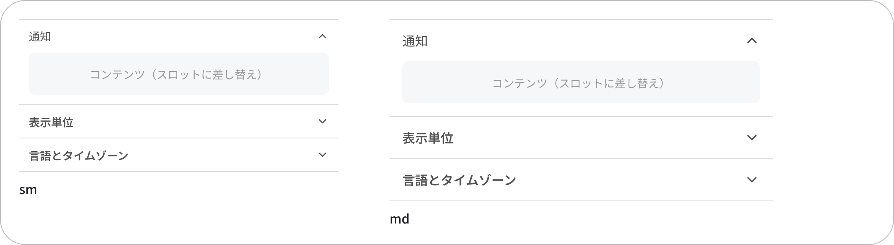

| 値 | 用途 |
| --- | --- |
| sm | パネルやテーブルの近くなど密度の高い場所 |
| md | 通常の画面。タッチ操作が中心の画面 |

### 開き方（type）

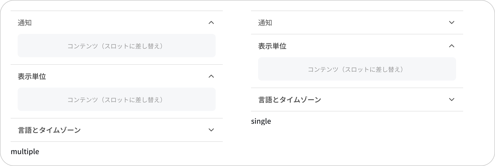

| 値 | 開き方 | 用途 |
| --- | --- | --- |
| multiple | 複数の項目を同時に開ける（既定） | 項目どうしを見比べる |
| single | 一度に1つだけ開く。別の項目を開くと、開いていた項目は閉じる | 手順のように1つずつ見せる |

single で collapsible=true のときは、開いている項目を閉じて、すべて閉じた状態にできます。

### アイコンの位置（iconPosition）

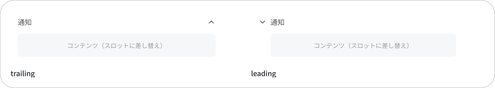

| 値 | アイコンの向き（閉 → 開） |
| --- | --- |
| trailing | 行の右端で下向き → 上向き（既定） |
| leading | タイトルの左で右向き → 下向き |

### 先頭側項目、末尾側項目（showLeadingItem / showTrailingItem）

先頭側にアイコン・アバター、末尾側にバッジ・アイコンを配置できます（複数配置できる）。

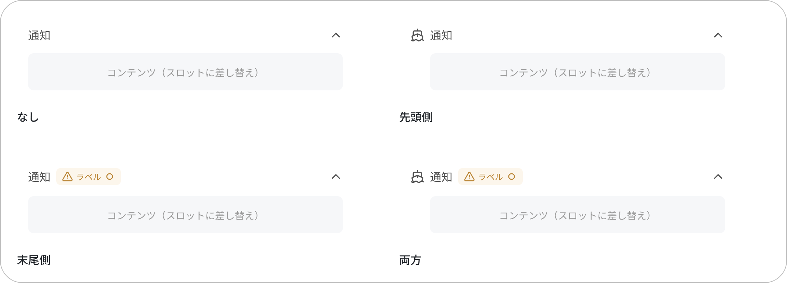

### 末尾側項目の位置（trailingItemAlign）

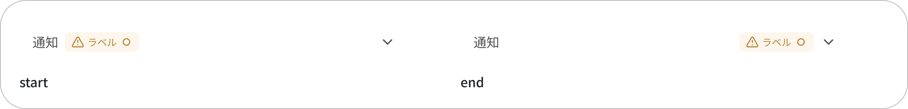

| 値 | 位置 |
| --- | --- |
| start | タイトルのすぐ右（既定）。タイトルが長いときは、文章と同じようにタイトルの最後の行の後ろに続く |
| end | 行の終わり側（アクション・開閉アイコンの手前） |

### アクション（showActions / actions）

見出しのボタンの外に操作を配置できます。trailing では開閉アイコンの左、leading では行の右端に配置し、押しても開閉しません。

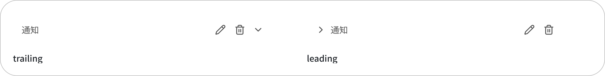

### 開閉（open）

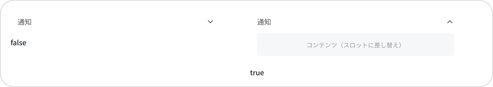

### 無効（disabled）

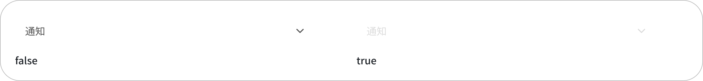

## 事例集

設定画面の項目をまとめる

航海の一覧（見出しの補足）

ダッシュボードの独立した項目

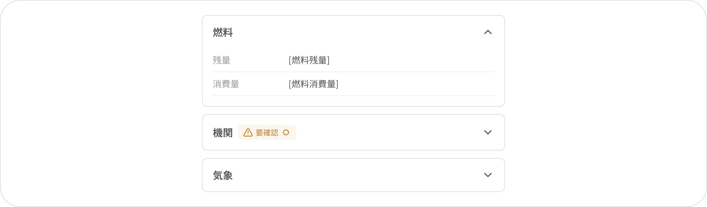

FAQ（長いタイトル）

タグのグループ（アクションあり）

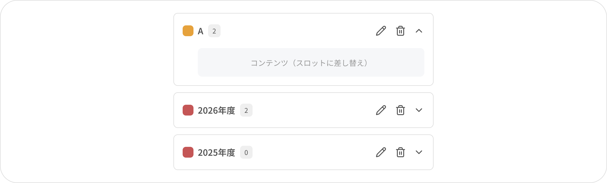

## 更新履歴

| 更新日 | 更新コンテンツ |
| --- | --- |
| 2026/09/28 | 新規作成 |
| 2026/10/07 | 種類に「開き方（type）」を追加 |
| 2026/10/08 | 構造に「アクション」、種類に「末尾側項目の位置（trailingItemAlign）」「アクション（showActions / actions）」、事例集に「タグのグループ（アクションあり）」を追加 |
