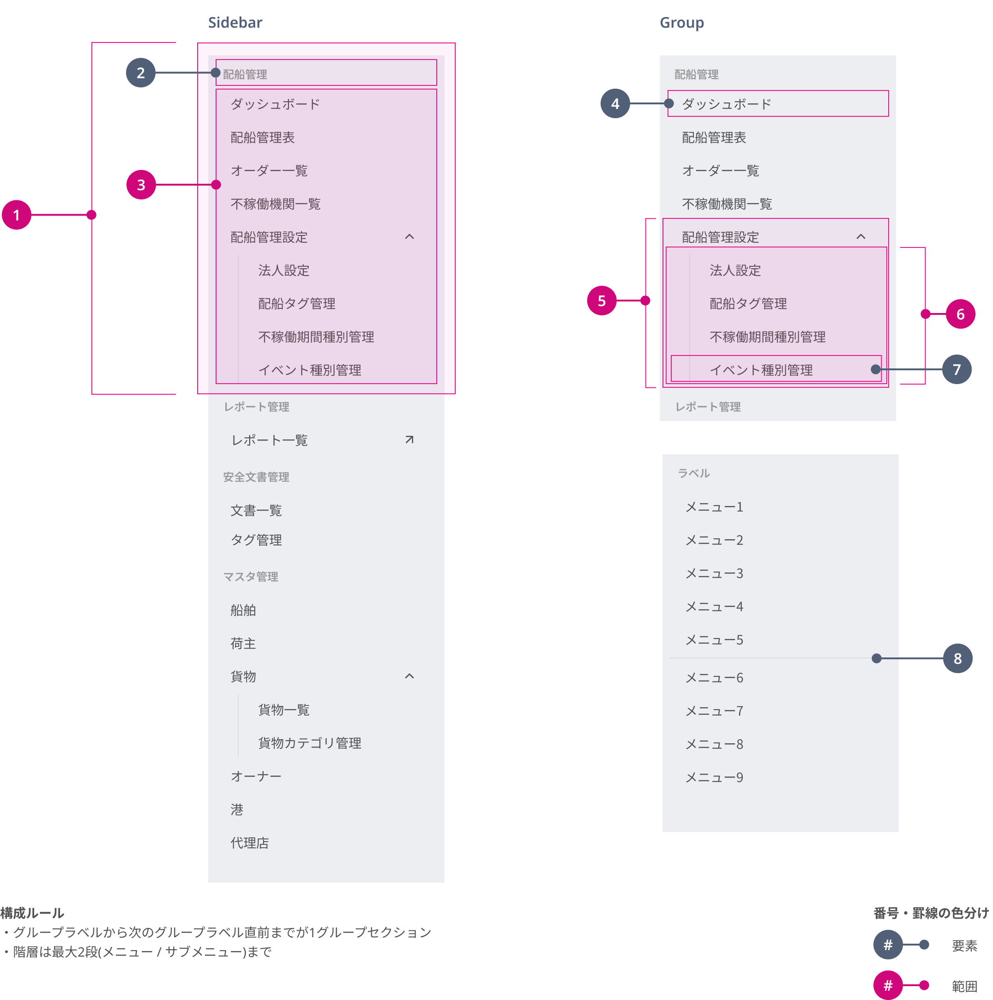
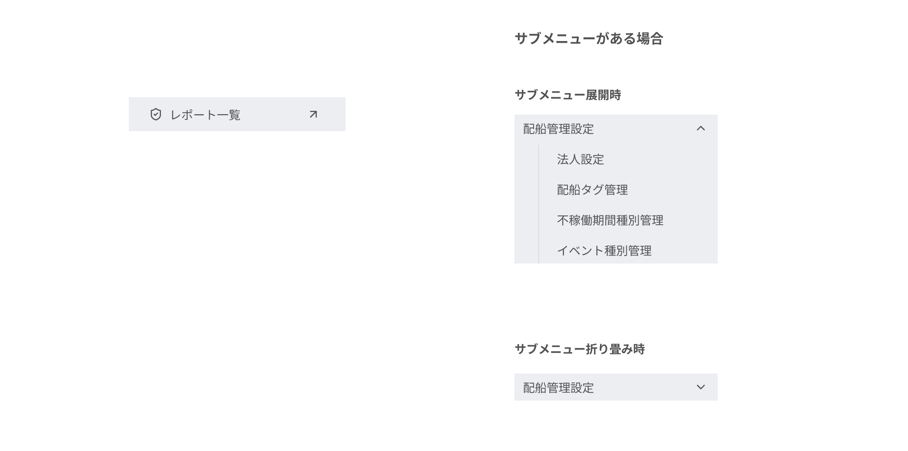
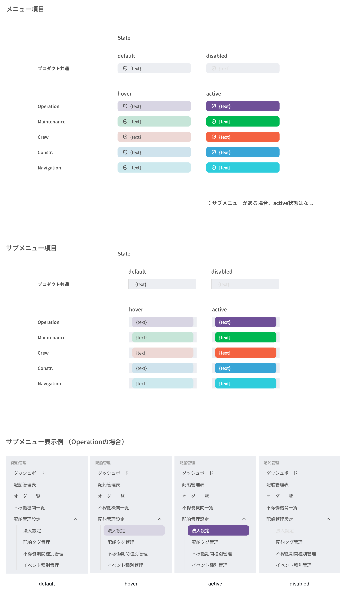
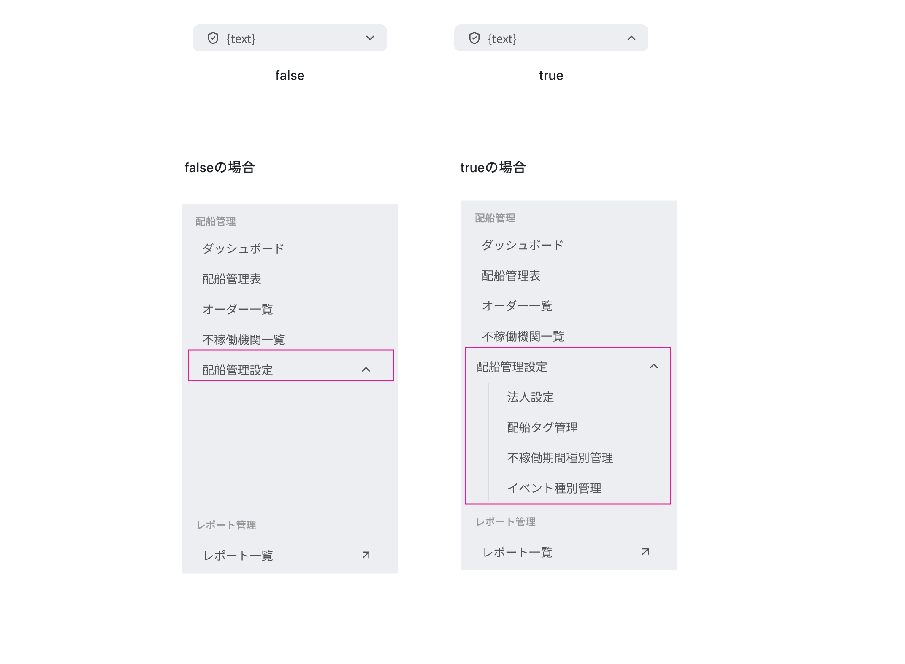
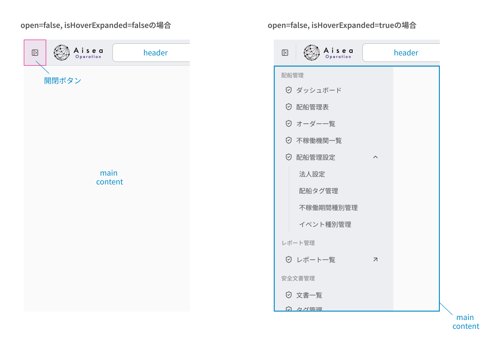

## 構造

### サイドバー

| 番号 | 名前 | Name | 説明 |
| --- | --- | --- | --- |
| 1 | グループセクション | Group Section | グループラベルとメニューセクション全体を含む領域 |
| 2 | グループラベル | Group Label | 表示有無は任意で選択可能 前後のアイコン設定は不可 |
| 3 | メニューセクション | Menu Section | メニュー項目のリスト領域 |
| 4 | メニュー項目（サブメニューなし） | Menu Item | クリックでメニューを表示 active状態を持つ |
| 5 | メニュー項目（サブメニューあり） | Menu Item | サブメニューを格納する デフォルトではサブメニューを展開する クリックでサブメニューを開閉する |
| 6 | サブメニューセクション | Sub Menu Section | サブメニュー項目のリスト領域 |
| 7 | サブメニュー項目 | Sub Menu Item | クリックでサブメニューを表示する active 状態を持つ |
| 8 | 区切り線 | Separator | メニュー内またはサブメニュー内での区切り線 |

### メニュー項目・サブメニュー項目

| 番号 | 名前 | Name | 説明 |
| --- | --- | --- | --- |
| 1 | 先頭側項目 | Leading Item | アイコンやバッジなどを表示 |
| 2 | 末尾側項目 | Trailing Item | アイコンやバッジなどを表示 サブメニューがある場合は、開閉状態に応じて既定のアイコンを表示 |
| 3 | テキスト | Text | 各項目のラベルを表示 |

## 種類

### メニュー項目・サブメニュー項目

#### 状態（state）

defaultとdisabledはプロダクトで共通のスタイルになります。

hoverとactiveはプロダクトごとに既定の色を表示します。

### メニュー項目

#### 開閉状態（open）

サブメニューの開閉状態です。サブメニューがある場合のみ有効です。

- false: 閉じている
- true: 開いている

デフォルトの開閉状態はプロパティで設定可能です。

（指定なしの場合はopen=true）

### サイドバー

#### 開閉状態(open)

サイドバー全体の開閉状態です。

- false: 閉じている
- true: 開いている

デフォルトの開閉状態はdefaultOpenプロパティで設定可能です。

（指定なしの場合はopen=true）

#### 開閉ボタンホバー時の開閉状態(isHoverExpanded)

メニューが閉じている場合に、ヘッダーの開閉ボタンをホバーすると動作します。

- false: 閉じている
- true: 開いている

## 更新履歴

| 更新日 | 更新内容 |
| --- | --- |
| 2026/08/28 | 新規追加 |
